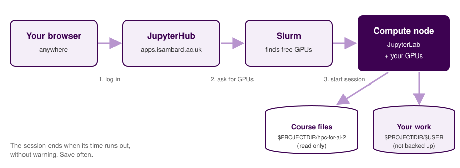

{width=220px fig-alt="University of Bristol logo"}

<!-- Course website hub: only rendered for the GitHub Pages build (render.py sets site: true) -->
::: {.content-visible when-meta="site"}
## About this page {.unnumbered .unlisted}

This page has everything you need for the course. The slides we use in the session are just below, followed by the full course notes, with all the exercises and answers. It's worth bookmarking so you can come back to it afterwards.

::: {.slides-embed}
```{=html}
<iframe id="slides-frame" src="slides.html" title="Course slides" allowfullscreen></iframe>
```
:::

::: {.hub-buttons}
```{=html}
<button type="button" class="btn hub-btn" onclick="document.getElementById('slides-frame').requestFullscreen()">⛶ Full screen</button>
<a class="btn hub-btn" href="slides.html" target="_blank" rel="noopener">Open slides in a new tab</a>
```
:::

Click on the slides, then use the arrow keys to move through them.

:::

# Introduction {.unnumbered}

In this course you'll use Isambard-AI, one of the UK's national supercomputers for AI research, to take a large language model (LLM) from a base model to a working research tool.

You will fine-tune Mistral 7B so that it learns to follow instructions, then call it from a program to label about 30,000 UK news headlines. An optional final section shows how to profile each step with Nsight Systems, to see what the GPU is really doing.

::: {.big-statement}
A model that only predicts the next word, one GPU and two hours. Can we turn it into a research tool?
:::

Each section of the course starts with a question, and you'll answer it by running part of a notebook on Isambard-AI:

::: {.flow}
[Set up]{.step} [→]{.arrow} [Fine-tuning?]{.step} [→]{.arrow} [LoRA and QLoRA]{.step} [→]{.arrow} [Did it work?]{.step} [→]{.arrow} [vLLM]{.step} [→]{.arrow} [Prompting]{.step} [→]{.arrow} [Headlines]{.step} [→]{.arrow} [Wrap up]{.step} [→]{.arrow} [Profiling (optional)]{.step .light}
:::

### How to get the most out of this course {.unnumbered}

The notebook is already written, so you won't need to type much code. Read each cell before you run it and make sure you know what it's doing. Work through the sections in order, in the one notebook, because later sections use models and variables from earlier ones. Sections marked **stretch goal** are extras for when you finish early or come back afterwards. Training takes about 8 minutes, which is a good moment to ask questions.

### Intended learning outcomes {.unnumbered}

By the end of this course, you should be able to:

- Explain the difference between training, fine-tuning and retrieval (RAG), and choose between them.
- Fine-tune a language model with LoRA or QLoRA, and justify the choice from measurements.
- Run a model over thousands of inputs in one batch, and check and retry its answers.
- State the limits of labels produced by a language model.
- Work considerately on a shared supercomputer.
- Optionally, record an Nsight profile of a running job and use it to explain why a job is slow.

### Audience level {.unnumbered}

This is an intermediate course for researchers who can program in Python and want to use language models in their work. You should be comfortable with:

- Python, Jupyter and pandas: [Introduction to Data Analysis in Python](https://bristol-training.github.io/data-analysis-python-2/).
- What a neural network and its training loop are: [Introduction to AI](https://bristol-training.github.io/intro-to-ai/). That course stops short of HPC and language models, and this one picks up from there.
- Running commands in a terminal: [Introduction to the Command Line](https://bristol-training.github.io/intro-cli/).

[HPC for AI - Part 1](https://bristol-training.github.io/hpc-for-ai-1/) introduces Isambard-AI and JupyterHub, and is useful but not required.

### What this course doesn't cover {.unnumbered}

Training a model from scratch, building a RAG system, multi-GPU training and running a model as a production service.

## How to read this document {.unnumbered}

Code from the course notebook is shown in a grey box with the notebook's name at the top. You'll find exactly the same code in one of the notebook's cells:

```{.python filename="hpc-for-ai-2.ipynb"}
def free_gpu():
    gc.collect()
    torch.cuda.empty_cache()
```

Commands to type into a terminal look like this:

```{.bash filename="Terminal"}
nvidia-smi
```

There's an exercise at the end of most sections, shown in a blue box. The answer is in the yellow box underneath; have a go yourself before you open it.

::: {#exampleN .callout-note icon=false title='Exercise'}
This is an exercise. Click on the box below to see the answer.
:::

::: {#answerN .callout-caution icon=false title='Answer (click to open)' collapse="true"}
This is the answer.
:::

Green boxes like this one sum up the main points of each section:

::: {#keypointsN .callout-tip icon=false title='Key points'}
These are the main points to take away.
:::

::: {.content-hidden when-meta="attendee"}
::: {.callout-important icon=false title='Instructor notes'}
Red boxes like this one are **instructor notes**. They are removed from the attendee copy of these notes (see `README.md`).

**How the session runs:** attendees run a complete notebook (`notebooks/hpc-for-ai-2.ipynb`) in JupyterHub on Isambard-AI, one GPU each. Introduce each section with the slides, then run the matching cells on your screen while attendees run them in their own session. Split the room in half, one half using `MODE = "qlora"` and the other `MODE = "lora"`, so that the whole group can compare the two in section 3 without anyone training twice.

**Suggested timings (2 hours):**

| Section | Topic | Approx. time |
|---|---|---|
| 1 | Setup | 0:00–0:05 |
| 2 | What is fine-tuning? | 0:05–0:20 |
| 3 | Training with LoRA and QLoRA | 0:20–0:50 |
| 4 | Did it work? | 0:50–1:00 |
| 5 | Faster inference with vLLM (start vLLM) | 1:00–1:05 |
| | Break | 1:05–1:20 |
| 5 | Faster inference with vLLM (continued) | 1:20–1:25 |
| 6 | Prompting from a program | 1:25–1:35 |
| 7 | A research question | 1:35–1:50 |
| 8 | Wrapping up and good practice | 1:50–2:00 |
| 9 | Optional: profiling | not timed |

Start the vLLM cell just before the break: it takes a minute or two the first time. If you're short of time, skip running the reviews demo in section 6, but do run the cells that define `run`, `clean` and `run_checked`.

Before the course, work through the [instructor setup](#sec-instructor-setup) at the end of these notes.
:::
:::

## Before the course {.unnumbered}

You'll need:

- An Isambard-AI account that has been added to the course project. We'll email you an invitation before the course; accept it and follow the steps in the email.
- A UNIX username, set in the BriCS portal. JupyterHub won't start without one. There are instructions in [Setting your UNIX username](https://docs.isambard.ac.uk/user-documentation/guides/shortname/).
- A web browser. Everything happens in the browser, so you don't need to install anything.

If you can, please check that you can log in to the [BriCS portal](https://portal.isambard.ac.uk) before the day.

# Setup

[How do I get a GPU with the model and data ready?]{.lead-question}

This course needs a GPU with plenty of memory, so unlike most Jean Golding Institute courses it won't run on a laptop. It runs on Isambard-AI, with everything already downloaded. Nothing needs a Hugging Face login.

{fig-alt="Your browser connects to JupyterHub, which asks the Slurm scheduler for GPUs. Slurm starts a JupyterLab session on a compute node. The compute node reads shared course data from the project folder and saves your work to your own folder."}

## Start a session

1. Go to <https://apps.isambard.ac.uk/aip2-jupyter> and log in.
2. Fill in the Server Options form:

| Field | What to choose |
|---|---|
| Project | The course project (we'll tell you its name) |
| Job duration | The shortest option that lasts until the end of the course |
| Number of GH200s | 1 |
| Partition | Leave this empty |
| Reservation | `interactive` |

3. Click **Start**. You might see "Pending in queue" while Slurm finds you a node.
4. JupyterLab opens in your browser once the node is ready.

::: {.callout-warning icon=false title='Your session has a time limit'}
When the time you chose runs out, the session ends straight away, with no warning. Save your notebook regularly (*Ctrl+S* or *Cmd+S*).
:::

## Set up the course kernel

The *kernel* is the Python environment your notebook runs in. We've made one especially for this course, with PyTorch, Transformers, TRL, PEFT and vLLM installed. You only have to install it once.

1. **Install the course kernel.** Open a terminal (*File → New → Terminal*) and run the command below, then reload the browser page.

    ```{.bash filename="Terminal"}
    bash $PROJECTDIR/course/kernels/install-kernels.sh
    ```

2. **Work on your own copy of the notebook.** If everyone saves the shared one, each save overwrites someone else's.

    ```{.bash filename="Terminal"}
    cp $PROJECTDIR/hpc-for-ai-2/notebooks/hpc-for-ai-2.ipynb ~/
    ```

3. **Check the kernel name** at the top right of the notebook says **Fine-tuning + Nsight**. Any other kernel gives errors such as `No module named 'datasets'`.
4. **Run one notebook at a time on this kernel.** Only the first one you open can be profiled in the optional section 9. Any others still run, but `nsys` can't record them.

## Where things live

| What | Where |
|---|---|
| Your results and profiles | `WORK_PATH`, which is `$PROJECTDIR/$USER/llm-fine-tuning` |
| Model | Shared cache, `$PROJECTDIR/course/hf-cache` |
| Datasets | `$PROJECTDIR/course/alpaca` and `$PROJECTDIR/course/headlines` |
| A trained adapter and example profiles, in case you fall behind | `$PROJECTDIR/course/fallback` |

The compute nodes can't connect to the internet, so the model and datasets were downloaded before the course. You can read the shared folder but not change it.

## Choose how to train

Choose how to train: `MODE = "qlora"` or `MODE = "lora"`. Section 3 explains the difference. In a taught session, you'll be told which to use.

```{.python filename="hpc-for-ai-2.ipynb"}
import gc, glob, json, os, random, time

import matplotlib.pyplot as plt
import pandas as pd
import torch
from datasets import load_dataset
from peft import LoraConfig, PeftModel
from transformers import AutoModelForCausalLM, AutoTokenizer, BitsAndBytesConfig
from trl import SFTConfig, SFTTrainer

MODE = "qlora"  # "qlora" or "lora"
MODEL_ID = "mistralai/Mistral-7B-v0.3"
PROJECTDIR = os.environ["PROJECTDIR"]
COURSE = f"{PROJECTDIR}/course"
WORK_PATH = os.environ["WORK_PATH"]
OUTPUT_DIR = f"{WORK_PATH}/sft-output/{MODE}"
os.makedirs(OUTPUT_DIR, exist_ok=True)
```

`free_gpu()` returns memory to the GPU after a model is deleted. We use it each time one model makes way for the next.

```{.python filename="hpc-for-ai-2.ipynb"}
def free_gpu():
    gc.collect()
    torch.cuda.empty_cache()
```

::: {#keypoints1 .callout-tip icon=false title='Key points'}
- JupyterHub asks the Slurm scheduler for a GPU and opens JupyterLab on a compute node.
- Install the course kernel once, and work on your own copy of the notebook.
- The model and data are shared and read-only; your results go in your own `WORK_PATH`.
:::

::: {.content-hidden when-meta="attendee"}
::: {.callout-important icon=false title='Instructor notes'}
**Recommended time:** 5 minutes. **Demo this on screen**, slowly. Tell each half of the room which `MODE` to use.

**Common problems:**

- *No UNIX username set*: the session won't start. Send them to the BriCS portal to set one; it can take a few minutes to work.
- *Not in the project*: the project won't appear in the drop-down list. Check they've accepted the invitation.
- *Someone has filled in Partition*: ask them to stop the server and start again with Partition empty.
- *"Pending in queue" for a long time*: each person can only have one interactive job at a time. Check with `squeue --me --partition=interactive`, and `scancel` any old job.
- *Kernel not in the list*: reload the browser page after running `install-kernels.sh`.
- *`No module named 'datasets'`*: the notebook is on the wrong kernel. Choose **Fine-tuning + Nsight** from the kernel menu.
- *`KeyError: 'PROJECTDIR'`, or files not found under `$PROJECTDIR`*: `$PROJECTDIR` is set from each person's default project. Check `echo $PROJECTDIR` in a terminal prints the course project's folder. If it doesn't, check which project they chose when starting the session.
:::
:::

::: {#exercise1 .callout-note icon=false title='Exercise'}
1. In a terminal, run `echo $PROJECTDIR`. Which folder does it print?
2. Run `nvidia-smi`. How much memory does your GPU have?
3. Check the kernel name in the top right of the notebook.
:::

::: {#answer1 .callout-caution icon=false title='Answer' collapse="true"}
1. The course project's folder. The shared course files are in `$PROJECTDIR/course`, and yours go in `$PROJECTDIR/$USER`.
2. One GH200, with about 96 GB of memory (`nvidia-smi` shows it in MiB).
3. **Fine-tuning + Nsight**. Any other kernel gives errors such as `No module named 'datasets'`.
:::

# What is fine-tuning?

[What does a base model do, and what will fine-tuning change?]{.lead-question}

## What a language model does

A language model is a neural network like the ones in Introduction to AI, trained in the same way, but far larger and with a Transformer architecture. Mistral 7B has 7.3 billion parameters.

Text goes in as **tokens**, which are whole words or pieces of words, each with a number. The model outputs a probability for every possible next token. To generate text, a program picks a token, adds it to the input and runs the model again, one token at a time.

So a base model is trained to do one thing: continue text the way the text it has read tends to continue. Answering a question is not a separate skill it has. That is what we are about to change.

## What fine-tuning is

**Fine-tuning** starts from a model that has already learned something general, and trains it a little further on a smaller, specific dataset. It needs far less data and compute than starting from nothing, because the model keeps most of what it already knows.

The idea is not specific to language models. Two examples:

| | Starts from | Learns | What it shows |
|---|---|---|---|
| **This notebook** | Mistral 7B, trained only to predict the next word | Alpaca's instruction and response format, from 3,200 examples | Behaviour changes visibly while training under 1% of the parameters |
| **[Forest-Chat](https://arxiv.org/abs/2601.14637)** (Brock, Zhang and Anantrasirichai, University of Bristol, 2026) | A forest-change detection model pretrained on the Forest-Change dataset | Change detection on woodland images from a different source, JL1-CD-Trees (408 samples) | Fine-tuning on 5–10% of the new data lifts accuracy well above using a model with no training on it. With all the new data, training from scratch sometimes does as well or better |

The second result is a useful warning: fine-tuning helps most when labelled data is scarce.

## Training, fine-tuning or RAG?

**Retrieval-augmented generation (RAG)** doesn't change the model at all. It searches your documents for text relevant to a question and adds that text to the prompt, so the model can answer from it.

| | Training from scratch | Fine-tuning | RAG |
|---|---|---|---|
| What changes | All the weights, starting from random | Some or all of the weights of a trained model | No weights: relevant text is added to the prompt |
| Data needed | Vast | Hundreds to thousands of labelled examples | Your documents, no labels |
| Compute | A very large cluster | One GPU, for minutes to hours | Mostly at question time, plus building a search index |
| Good for | Creating new foundation models | A format, style or narrow skill | Facts the model doesn't have, or that change |
| Weakness | Cost | Fixed once trained, and doesn't reliably add facts | Only as good as what it retrieves |

Choose in this order:

1. **Try prompting first.** If a good instruction gets you what you need, you don't need to train anything.
2. **Use RAG** if the model needs facts it doesn't have.
3. **Fine-tune** if you need a consistent format, style or narrow skill, and you have labelled examples.
4. **Train from scratch** almost never: few research groups have the data or the compute.

## Tokenizer

The tokenizer turns text into the token IDs the model reads. Training groups examples of different lengths into a batch, and the shorter ones need padding. Mistral 7B has no padding token, so we reuse the end-of-sequence token, the usual choice for this kind of model.

```{.python filename="hpc-for-ai-2.ipynb"}
tokenizer = AutoTokenizer.from_pretrained(MODEL_ID)
tokenizer.pad_token = tokenizer.eos_token
```

## Dataset

Stanford Alpaca has about 52,000 instruction-following examples. Each is already a single `text` field in one fixed layout: an instruction, then `### Response:`, then the answer. This layout is what the model learns to complete.

Alpaca is for non-commercial use, so check the licence before reusing it. This copy was saved to the course folder before the session. (Online, it loads with `load_dataset("tatsu-lab/alpaca", split="train")`.)

```{.python filename="hpc-for-ai-2.ipynb"}
dataset = load_dataset("parquet", data_files=f"{COURSE}/alpaca/train.parquet", split="train")

print(len(dataset), "examples")
print(dataset[0]["text"])
```

## What can the base model do?

Before training anything, see what the model does on its own. It has read a vast amount of text, but it was only ever trained to predict the next word. It has never been taught to answer.

Give it the start of a sentence. What comes back is a plausible continuation, which is not necessarily the fact you were hoping for.

```{.python filename="hpc-for-ai-2.ipynb"}
base_model = AutoModelForCausalLM.from_pretrained(MODEL_ID, dtype=torch.bfloat16, device_map="cuda")


def complete(model, text, max_new_tokens=40):
    inputs = tokenizer(text, return_tensors="pt").to(model.device)
    output = model.generate(**inputs, max_new_tokens=max_new_tokens, do_sample=False,
                            pad_token_id=tokenizer.eos_token_id)
    return tokenizer.decode(output[0][inputs["input_ids"].shape[1]:], skip_special_tokens=True)


print(complete(base_model, "The capital of France is"))
```

Now ask a direct question. A base model often treats a question as the start of a document rather than something to answer, so it may write more questions or repeat itself.

```{.python filename="hpc-for-ai-2.ipynb"}
print(complete(base_model, "What is the capital of France?", max_new_tokens=80))
```

Now put questions into the layout that fine-tuning will teach. The first question is the very first example in Alpaca, so the fine-tuned model will have seen it. The others are not in the dataset, so they show whether it has learned to answer in general.

Look at how each answer **ends**. Does it stop, or carry on and write a new `### Instruction:` of its own? We'll ask the same questions after training. Add your own to the list if you like.

```{.python filename="hpc-for-ai-2.ipynb"}
QUESTIONS = [
    "Give three tips for staying healthy.",
    "Explain what a GPU is to a ten-year-old.",
    "Suggest a name for a bakery in Bristol and explain your choice.",
    "List the planets of the solar system in order from the Sun.",
]
TEMPLATE = ("Below is an instruction that describes a task. "
            "Write a response that appropriately completes the request.\n\n"
            "### Instruction:\n{question}\n\n### Response:\n")


def ask(model, question):
    return complete(model, TEMPLATE.format(question=question), max_new_tokens=150)
```

```{.python filename="hpc-for-ai-2.ipynb"}
for question in QUESTIONS:
    print("Q:", question, "\nBASE MODEL:", ask(base_model, question), "\n" + "-" * 60)

del base_model
free_gpu()
```

::: {#keypoints2 .callout-tip icon=false title='Key points'}
- A base language model only continues text, one token at a time; answering questions is not a separate skill it has.
- Fine-tuning trains an existing model a little further on a small, specific dataset.
- Try prompting first, use RAG for missing facts, and fine-tune for a format, style or narrow skill.
:::

::: {.content-hidden when-meta="attendee"}
::: {.callout-important icon=false title='Instructor notes'}
**Recommended time:** 15 minutes. Loading the base model takes a minute or so: talk through the training, fine-tuning and RAG table while it loads. Ask the room how the base model's answers end.
:::
:::

::: {#exercise2 .callout-note icon=false title='Exercise'}
Add a question of your own to `QUESTIONS`. Before you run the cell, predict: will the base model answer it and stop, or carry on writing? Then run it and check.
:::

::: {#answer2 .callout-caution icon=false title='Answer' collapse="true"}
Usually it carries on. The base model was only trained to continue text, so it may answer briefly and then write a new `### Instruction:` of its own, or repeat itself. Keep your question in the list: you'll ask the fine-tuned model the same thing in section 4.
:::

# Training with LoRA and QLoRA

[How do you fine-tune a 7-billion-parameter model on one GPU?]{.lead-question}

## How LoRA and QLoRA fit it on one GPU

Fine-tuning every weight in mixed precision with the AdamW optimiser costs about 16 bytes per parameter: the weights, their gradients, a 32-bit master copy and two optimiser values. For 7.3 billion parameters that is about 117 GB, more than the 96 GB on this GPU.

**LoRA** freezes the model and adds two small trainable matrices beside each layer. Only those train. A layer's weights `W` stay as they are, and small matrices `A` and `B` learn an update to them, so the layer behaves as if its weights were

```
W + (alpha / r) × B A
```

The trick is the size. A 4096 × 4096 matrix has about 16.8 million values. With rank `r = 16`, `A` and `B` hold 16 × (4096 + 4096), or about 131,000, which is around 128 times fewer. The price is that the update can only express `r` independent directions in each layer, which is usually enough for a change in behaviour, because the model already knows most of what it needs.

**QLoRA** does the same, and also stores the frozen weights in 4 bits instead of 16. It uses a format called NF4, which places its few available values to suit the bell-shaped spread typical of model weights. Each weight is unpacked at every use, so it saves memory at the cost of extra compute. Only the frozen weights are compressed: the adapters still train at full precision.

The Isambard tutorial measured about 119 GiB, 16 GiB and 5 GiB for full fine-tuning, LoRA and QLoRA on the similar Llama 3.1 8B.

## Training settings

The next three cells only define settings. The comments explain each one, and `lora_alpha=32` with `r=16` makes `alpha / r` equal to 2 in the formula above.

```{.python filename="hpc-for-ai-2.ipynb"}
quantization_config = BitsAndBytesConfig(
    load_in_4bit=True,
    bnb_4bit_quant_type="nf4",             # the 4-bit format
    bnb_4bit_compute_dtype="bfloat16",     # unpack to this for every multiplication
    bnb_4bit_use_double_quant=True,        # also compress the format's scaling constants
)

if MODE == "qlora":
    model_init_kwargs = {"quantization_config": quantization_config, "dtype": "bfloat16"}
else:
    model_init_kwargs = {"dtype": "bfloat16"}
```

```{.python filename="hpc-for-ai-2.ipynb"}
lora_config = LoraConfig(
    r=16,                         # rank: the size of the small matrices
    lora_alpha=32,                # how strongly the adapter's output is added
    lora_dropout=0.05,            # drop 5% of adapter inputs, to reduce overfitting
    bias="none",
    task_type="CAUSAL_LM",
    target_modules="all-linear",  # put an adapter on every linear layer
)
```

```{.python filename="hpc-for-ai-2.ipynb"}
training_args = SFTConfig(
    output_dir=OUTPUT_DIR, report_to="none",
    dataset_text_field="text", max_length=1024,
    packing=False,                                       # packing needs Flash Attention
    max_steps=200,                                       # 200 × 16 = 3,200 examples, about 6% of Alpaca
    per_device_train_batch_size=4,
    gradient_accumulation_steps=4,                       # each update uses 4 × 4 = 16 examples
    gradient_checkpointing=True,                         # recompute, not store: less memory, more compute
    learning_rate=2e-4, lr_scheduler_type="cosine", warmup_steps=10,
    logging_steps=10, save_steps=100, bf16=True,
    model_init_kwargs=model_init_kwargs,
)
```

## Train

`SFTTrainer` loads the model, wraps it with the LoRA adapters and tokenises the dataset. The printed line shows how few parameters train: about 42 million of 7.3 billion, or 0.58%.

```{.python filename="hpc-for-ai-2.ipynb"}
trainer = SFTTrainer(model=MODEL_ID, args=training_args, train_dataset=dataset,
                     processing_class=tokenizer, peft_config=lora_config)
trainer.model.print_trainable_parameters()
```

Training takes 8 to 9 minutes. The loss is printed every 10 steps and should fall as the adapter learns the format.

::: {.callout-note icon=false title='Doing the optional profiling section?'}
Training is the only chance to record a slice of it. Read [Record a profile](#sec-record-profile) in section 9 and run its commands in a terminal once the loss has started printing.
:::

```{.python filename="hpc-for-ai-2.ipynb"}
torch.cuda.reset_peak_memory_stats()
with torch.cuda.nvtx.range("train"):
    result = trainer.train()

stats = {
    "mode": MODE,
    "train_minutes": round(result.metrics["train_runtime"] / 60, 1),
    "samples_per_second": round(result.metrics["train_samples_per_second"], 2),
    "peak_memory_gib": round(torch.cuda.max_memory_allocated() / 1024**3, 1),
    "final_loss": round(result.training_loss, 3),
}
with open(f"{OUTPUT_DIR}/stats.json", "w") as f:
    json.dump(stats, f)
stats
```

Save the adapter. This writes only the small LoRA matrices, 84 MB for QLoRA or 168 MB for LoRA, not a copy of the 14.5 GB model. Using it later means loading the base model and attaching the adapter, as we do below.

**Behind, or training failed?** Set `USE_FALLBACK = True` in the next cell, and carry on from there with a trained adapter we prepared earlier.

```{.python filename="hpc-for-ai-2.ipynb"}
USE_FALLBACK = False  # True if you are behind or training failed

if USE_FALLBACK:
    ADAPTER = f"{COURSE}/fallback/{MODE}/final"
else:
    ADAPTER = f"{OUTPUT_DIR}/final"
    trainer.save_model(ADAPTER)

trainer = None
free_gpu()
```

## LoRA vs QLoRA: the whole room's results

This cell reads the `stats.json` of everyone in the project, so it fills up as people finish. Run it again later for the final numbers.

**What to expect:** QLoRA should use clearly less memory. LoRA should train faster, because QLoRA unpacks its 4-bit weights for every multiplication. Final losses should be similar.

```{.python filename="hpc-for-ai-2.ipynb"}
rows = []
for path in glob.glob(f"{PROJECTDIR}/*/llm-fine-tuning/sft-output/*lora/stats.json"):
    try:
        with open(path) as f:
            rows.append(json.load(f))
    except (OSError, ValueError):
        pass  # someone's file is unreadable or half-written

results = pd.DataFrame(rows)
results.groupby("mode").mean().round(2).assign(people=results["mode"].value_counts())
```

## Why is QLoRA slower?

**What we measured** (yours will differ a little):

| | LoRA | QLoRA |
|---|---|---|
| Training time | 8.0 min | 8.8 min |
| Peak GPU memory | 16.1 GiB | 5.8 GiB |
| Final loss | 0.903 | 0.908 |

A profile of 20 seconds of each run shows why. QLoRA's longest-running GPU kernel is `kDequantizeBlockwise`, which unpacks the 4-bit weights back to 16 bits before every multiplication: 18% of all kernel time. LoRA doesn't run it at all. So QLoRA pays about 10% more time for about 64% less memory, and both learn equally well.

**Which to choose?** Use LoRA when the model fits comfortably on your GPU, because it is faster. Use QLoRA when it doesn't: a bigger model, longer inputs or a smaller GPU. Section 9 shows how to record and read these profiles yourself.

::: {#keypoints3 .callout-tip icon=false title='Key points'}
- Full fine-tuning of a 7-billion-parameter model needs about 117 GB, more than one GPU has.
- LoRA trains small adapter matrices beside frozen weights: under 1% of the parameters.
- QLoRA also stores the frozen weights in 4 bits: about 64% less memory than LoRA, for about 10% more time, with the same final loss.
- Choose LoRA when the model fits, and QLoRA when it doesn't.
:::

::: {.content-hidden when-meta="attendee"}
::: {.callout-important icon=false title='Instructor notes'}
**Recommended time:** 30 minutes. Training takes 8 to 9 minutes, so use that time to talk through LoRA and QLoRA, and what the whole room's results table will show. Re-run the results cell once most people have finished, and compare it with the measured table.

**Behind or failed?** Anyone more than a few minutes behind, or whose training fails, sets `USE_FALLBACK = True` and carries on.
:::
:::

::: {#exercise3 .callout-note icon=false title='Exercise'}
1. When most of the room has finished, run the results cell again. Do the room's numbers match the measured table?
2. You want to fine-tune a model twice the size, about 14 billion parameters, on one GH200. LoRA or QLoRA?
:::

::: {#answer3 .callout-caution icon=false title='Answer' collapse="true"}
1. They should be close: QLoRA uses about a third of LoRA's memory and takes about 10% longer, and the final losses are similar.
2. LoRA's 16 GiB is mostly the frozen weights, at 2 bytes per parameter. A 14-billion-parameter model needs about 28 GB for its weights, which still fits in 96 GB, so LoRA, because it's faster. QLoRA becomes necessary when the 16-bit weights no longer fit, for example a 70-billion-parameter model.
:::

# Did it work?

[Has the model learned to answer?]{.lead-question}

Load the base model and attach the adapter. `disable_adapter()` switches the adapter off temporarily, so the same model gives both answers. Look at how the answers end again. Compare the first question, which was in the training data, with the others.

Falling loss alone doesn't prove the model is better, because a model can memorise its training data. That's why we also try questions it hasn't seen. A real project would hold back a test set.

```{.python filename="hpc-for-ai-2.ipynb"}
model = AutoModelForCausalLM.from_pretrained(MODEL_ID, dtype=torch.bfloat16, device_map="cuda")
model = PeftModel.from_pretrained(model, ADAPTER)
```

This uses Transformers' `generate()`: one question at a time, one token at a time. The cell times it, so we can compare it with a faster way in the next section.

```{.python filename="hpc-for-ai-2.ipynb"}
start = time.perf_counter()
with torch.cuda.nvtx.range("generate-hf"):
    for question in QUESTIONS:
        with model.disable_adapter():
            print("Q:", question, "\nBASE MODEL:", ask(model, question))
        print("\nFINE-TUNED MODEL:", ask(model, question), "\n" + "-" * 60)
hf_seconds = time.perf_counter() - start
print(f"Transformers generate(): {hf_seconds:.1f} s for {2 * len(QUESTIONS)} answers")
```

::: {#keypoints4 .callout-tip icon=false title='Key points'}
- A LoRA adapter is attached to the base model, and can be switched off to compare the two.
- Falling loss doesn't prove a model is better: check it on questions it hasn't seen.
:::

::: {.content-hidden when-meta="attendee"}
::: {.callout-important icon=false title='Instructor notes'}
**Recommended time:** 10 minutes. Ask the room whether the fine-tuned answers now stop at the end, and whether any are worse than the base model's.
:::
:::

::: {#exercise4 .callout-note icon=false title='Exercise (stretch goal)'}
Add a question of your own to `QUESTIONS`, re-run that cell's definition and ask both models. Can you find a question where the fine-tuned model is clearly *worse*? Remember it trained on 3,200 examples for 8 minutes: it learned a format, not new knowledge.
:::

::: {#answer4 .callout-caution icon=false title='Answer' collapse="true"}
Answers will vary. Questions that need up-to-date or specialist facts are a good place to look: the fine-tuned model answers in the right format, but no more accurately than the base model, and it can state wrong facts just as confidently.
:::

# Faster inference with vLLM

[How do we get answers fast enough to use in a program?]{.lead-question}

So far we have asked questions by hand. In research, a model is usually one step inside a program: it runs over thousands of inputs, and its answers are checked and stored.

For that we need speed, so we switch to **vLLM**, an inference engine with two main tricks:

- **Batching:** it works on all the questions at once, instead of one after another.
- **CUDA graphs:** it records the GPU work for one step once, then replays it, instead of Python launching every kernel separately at every token.

Batching suits a GPU because a GPU applies the same operation to many values at once. Thirty-two questions become a matrix with 32 rows, and the multiplication is still about one kernel, so the work per question falls sharply. Launching a kernel from Python also takes time on the CPU, while the GPU waits, and a replayed graph avoids most of that.

vLLM loads the base model once and attaches the adapter only for requests that ask for it. `gpu_memory_utilization=0.8` lets it use 80% of the GPU's memory.

Start it now. It measures memory and records its CUDA graphs, which takes about a minute or two the first time, so this is a good cell to run just before the break.

```{.python filename="hpc-for-ai-2.ipynb"}
del model
free_gpu()

from vllm import LLM, SamplingParams
from vllm.lora.request import LoRARequest

llm = LLM(model=MODEL_ID, enable_lora=True, max_lora_rank=16,
          max_model_len=1024, gpu_memory_utilization=0.8)
adapter = LoRARequest(MODE, 1, ADAPTER)
```

**Break.** Take 15 minutes once the cell above has finished.

Now the same questions. `temperature=0` always picks the most likely next token, matching `do_sample=False` above, so the answers should match the Transformers ones closely. Small differences are normal, because the two libraries add numbers up in a different order.

```{.python filename="hpc-for-ai-2.ipynb"}
settings = SamplingParams(temperature=0, max_tokens=150)
prompts = [TEMPLATE.format(question=q) for q in QUESTIONS]

start = time.perf_counter()
with torch.cuda.nvtx.range("generate-vllm"):
    base_answers = llm.generate(prompts, settings)
    tuned_answers = llm.generate(prompts, settings, lora_request=adapter)
vllm_seconds = time.perf_counter() - start

for question, tuned in zip(QUESTIONS, tuned_answers):
    print("Q:", question, "\nFINE-TUNED MODEL:", tuned.outputs[0].text, "\n" + "-" * 60)
print(f"Transformers: {hf_seconds:.1f} s   vLLM: {vllm_seconds:.1f} s")
```

## Why is vLLM so much faster?

Same questions, same adapter, same GPU. Most of the gap is **not** faster arithmetic. With Transformers, Python launches every GPU kernel itself, one question and one token at a time, and the GPU spends most of its time waiting for the next instruction. vLLM batches the questions, so there are far fewer steps, and replays CUDA graphs, so Python no longer launches each kernel. Section 9 shows the profiles behind this.

::: {#keypoints5 .callout-tip icon=false title='Key points'}
- vLLM batches requests and replays CUDA graphs, so it answers far faster than Transformers' `generate()`.
- One model can serve both the base model and an adapter, attached per request.
:::

::: {.content-hidden when-meta="attendee"}
::: {.callout-important icon=false title='Instructor notes'}
**Recommended time:** 10 minutes, split around the break. Run the vLLM start-up cell just before the break: it takes a minute or two.
:::
:::

::: {#exercise5 .callout-note icon=false title='Exercise'}
The last cell prints the Transformers and vLLM times for the same questions. How many times faster is vLLM? Which two tricks make the difference?
:::

::: {#answer5 .callout-caution icon=false title='Answer' collapse="true"}
In our dry run, about 47 seconds against under 2 seconds: more than 20 times faster. **Batching** answers all the questions at once instead of one after another, and **CUDA graphs** replay the GPU work for each step instead of Python launching every kernel. Your times will differ.
:::

# Prompting from a program

[How do you use a model on a list of inputs, and trust what comes back?]{.lead-question}

## One instruction over many inputs

The most common use of a model in a program is to label, summarise or extract something from a list of texts. The instruction stays the same and the input changes, so we use Alpaca's second template, which has an `### Input:` block.

`stop=["###"]` ends the answer as soon as the model starts a new block. Give `run` the whole list at once, not one item per call, so vLLM can batch it.

Pass `lora_request=None` to use the base model instead of your adapter.

```{.python filename="hpc-for-ai-2.ipynb"}
TEMPLATE_WITH_INPUT = (
    "Below is an instruction that describes a task, paired with an input that provides further context. "
    "Write a response that appropriately completes the request.\n\n"
    "### Instruction:\n{instruction}\n\n### Input:\n{input}\n\n### Response:\n")
loop_settings = SamplingParams(temperature=0, max_tokens=150, stop=["###"])


def run(instruction, inputs, settings=loop_settings, lora_request=adapter):
    """Ask one instruction for each input, all in one batch."""
    prompts = [TEMPLATE_WITH_INPUT.format(instruction=instruction, input=text) for text in inputs]
    outputs = llm.generate(prompts, settings, lora_request=lora_request)
    return [out.outputs[0].text.strip() for out in outputs]
```

Some made-up reviews to try it on. To use your own data, read a column into the list, for example `pd.read_csv("my_data.csv")["text"].tolist()`.

```{.python filename="hpc-for-ai-2.ipynb"}
reviews = [
    "The battery lasts all day and the screen is lovely.",
    "Stopped working after a week. Support never replied.",
    "It does the job. Nothing special.",
    "Absolutely brilliant, I've already bought a second one.",
    "Arrived late and the box was damaged, but the product itself is fine.",
    "Too expensive for what you get.",
]
SENTIMENT = "Classify the sentiment of this review as positive, negative or neutral. Answer with one word."

for review, label in zip(reviews, run(SENTIMENT, reviews)):
    print(f"{label!r:12} {review}")
```

## Check every answer, and retry the failures

A program needs answers in a form it can use, and a model doesn't always oblige: it may answer "Positive." with a capital and a full stop, or write a sentence. So `run_checked`:

1. **Cleans** each answer: lower case, first word only, no punctuation.
2. **Checks** it against the answers you allow.
3. **Retries** only the failures, with `temperature=0.7`. At temperature 0 a retry would repeat the same mistake, so a little randomness gives the model another chance.
4. **Gives up** after a few attempts and returns `None` rather than guessing, so you can see and count the failures.

It tracks answers by their position in the list, because the same text can appear twice.

```{.python filename="hpc-for-ai-2.ipynb"}
retry_settings = SamplingParams(temperature=0.7, max_tokens=20, stop=["###"])


def clean(answer):
    words = answer.lower().split()
    return words[0].strip(".,!:;\"'") if words else ""
```

```{.python filename="hpc-for-ai-2.ipynb"}
def run_checked(instruction, inputs, allowed, settings=loop_settings, lora_request=adapter):
    answers = [clean(a) for a in run(instruction, inputs, settings, lora_request)]
    for attempt in range(3):
        failed = [i for i, a in enumerate(answers) if a not in allowed]
        if failed:
            print(f"Retrying {len(failed)} answer(s)")
            for i, a in zip(failed, run(instruction, [inputs[i] for i in failed], retry_settings, lora_request)):
                answers[i] = clean(a)
    return [a if a in allowed else None for a in answers]
```

```{.python filename="hpc-for-ai-2.ipynb"}
labels = run_checked(SENTIMENT, reviews, {"positive", "negative", "neutral"})

table = pd.DataFrame({"review": reviews, "sentiment": labels})
table.to_csv(f"{OUTPUT_DIR}/sentiment.csv", index=False)
table
```

::: {#keypoints6 .callout-tip icon=false title='Key points'}
- Send the whole list of inputs in one call, so vLLM can batch it.
- Clean and check every answer, retry only the failures with a little randomness, and return `None` rather than guess.
:::

::: {.content-hidden when-meta="attendee"}
::: {.callout-important icon=false title='Instructor notes'}
**Recommended time:** 10 minutes. If short of time, skip running the reviews demo (the three cells that use `reviews`), but do run the cells that define `run`, `clean` and `run_checked`.
:::
:::

::: {#exercise6 .callout-note icon=false title='Exercise'}
Use `run_checked` with a new instruction on the reviews, for example asking which topic each review is about, from `battery`, `screen`, `delivery`, `price` or `other`. How many answers come back as `None`?
:::

::: {#answer6 .callout-caution icon=false title='Answer' collapse="true"}
```{.python}
TOPIC = ("Which topic is this review mostly about: battery, screen, delivery, price or other? "
         "Answer with one word.")
topics = run_checked(TOPIC, reviews, {"battery", "screen", "delivery", "price", "other"})
pd.DataFrame({"review": reviews, "topic": topics})
```

Answers will vary. A `None` means the model kept answering with a word you didn't allow, such as `quality`. Either add it to the allowed set or make the instruction clearer, then count again.
:::

# A research question

[Has each UK news outlet given more or less of its front page to the environment?]{.lead-question}

## The environment on UK front pages

Has each UK news outlet given more or less of its front page to the environment over the last two years?

The data comes from [The Hear](https://www.thehear.org), a nonprofit archive of the lead headline on each UK outlet's front page. We sampled its archive every 6 hours from September 2024 to October 2026 and saved the result before the session. The scripts are in `$PROJECTDIR/hpc-for-ai-2/setup/headlines/`.

The file is a nested dictionary, `data[paper][year][title]`. We flatten it into one list.

```{.python filename="hpc-for-ai-2.ipynb"}
with open(f"{COURSE}/headlines/uk_headlines.json") as f:
    data = json.load(f)

rows = [(paper, int(year), title, info["subtitle"])
        for paper, years in data.items()
        for year, titles in years.items()
        for title, info in titles.items()]

print(len(rows), "headlines from", len(data), "outlets")
for paper, year, title, subtitle in random.Random(0).sample(rows, 5):
    print(f"{paper} ({year}): {title}")
```

## One at a time

Our fine-tuned model becomes the classifier: each headline and its subtitle go in the `### Input:` block, and the instruction asks for yes or no. `max_tokens=5` is enough for one word.

First, the obvious way to write it: a function that asks about one headline and returns True or False, called once per headline. This is how most code calls a function. We only try it on 50 headlines. Each call hands vLLM a single prompt, so it has nothing to batch.

```{.python filename="hpc-for-ai-2.ipynb"}
CLASSIFY = ("Is this news headline about the environment, for example climate change, extreme weather, "
            "energy, pollution, wildlife or nature? Answer yes or no.")
classify_settings = SamplingParams(temperature=0, max_tokens=5, stop=["###"])
inputs = [f"{title}\n{subtitle}" if subtitle else title for _, _, title, subtitle in rows]


def is_about_environment(text):
    prompt = TEMPLATE_WITH_INPUT.format(instruction=CLASSIFY, input=text)
    output = llm.generate([prompt], classify_settings, lora_request=adapter, use_tqdm=False)
    return clean(output[0].outputs[0].text) == "yes"
```

```{.python filename="hpc-for-ai-2.ipynb"}
start = time.perf_counter()
with torch.cuda.nvtx.range("classify-loop"):
    loop_labels = [is_about_environment(text) for text in inputs[:50]]
loop_seconds = time.perf_counter() - start

print(f"One at a time: {loop_seconds:.1f} s for 50 headlines, {20 * loop_seconds:.0f} ms each")
print(f"All {len(rows)} would take about {loop_seconds / 50 * len(rows) / 60:.0f} minutes")
```

## All at once

The fix is to gather every headline into a list first, classify the whole list in one call, and only then loop over the answers. `run_checked` already works this way.

Compare the time per headline with the loop. The batch is about 20 times faster per headline, and section 9 shows why that is not just because the GPU sat idle between calls.

```{.python filename="hpc-for-ai-2.ipynb"}
start = time.perf_counter()
with torch.cuda.nvtx.range("classify-batch"):
    labels = run_checked(CLASSIFY, inputs, {"yes", "no"}, classify_settings)
batch_seconds = time.perf_counter() - start

print(f"All at once: {batch_seconds:.1f} s for {len(rows)} headlines, "
      f"{1000 * batch_seconds / len(rows):.1f} ms each")
print("Unanswered:", labels.count(None))
print("Same answer as the loop:", sum(a == (b == "yes") for a, b in zip(loop_labels, labels)), "of 50")
```

## Count and plot

Two tables of zeros, one row per year and one column per outlet. Add 1 for every headline and, in the second table, for every environment headline. Dividing one by the other gives each outlet's share. An outlet with no headlines in a year shows `NaN`.

```{.python filename="hpc-for-ai-2.ipynb"}
counts = pd.DataFrame(0, index=sorted({r[1] for r in rows}), columns=sorted(data))
env_counts = counts.copy()

for (paper, year, _, _), label in zip(rows, labels):
    counts.loc[year, paper] += 1
    if label == "yes":
        env_counts.loc[year, paper] += 1

share = (100 * env_counts / counts).round(1)
share.to_csv(f"{OUTPUT_DIR}/environment_share.csv")
share.T
```

```{.python filename="hpc-for-ai-2.ipynb"}
big = counts.columns[counts.sum() >= 100]  # too few headlines makes a percentage meaningless
order = share[big].mean().sort_values().index

ax = share[order].T.plot.barh(figsize=(8, 0.4 * len(order) + 1), width=0.8)
ax.set_xlabel("% of lead headlines about the environment")
ax.legend(title="Year")
plt.tight_layout()
plt.show()
```

Check by eye: are these really about the environment?

```{.python filename="hpc-for-ai-2.ipynb"}
yes = [(paper, title) for (paper, _, title, _), label in zip(rows, labels) if label == "yes"]
print(len(yes), "headlines labelled yes. A random 15:")
for paper, title in random.Random(0).sample(yes, min(15, len(yes))):
    print(f"  {paper:22} {title}")
```

::: {#keypoints7 .callout-tip icon=false title='Key points'}
- Calling a model once per input is the obvious code, but the slow way: gather the inputs into a list and classify them in one call.
- Always check a sample of a model's labels by eye.
:::

::: {.content-hidden when-meta="attendee"}
::: {.callout-important icon=false title='Instructor notes'}
**Recommended time:** 15 minutes. The batched cell classifies all 29,823 headlines in under a minute; the loop would take about 16 minutes for the same.
:::
:::

# Wrapping up and good practice

[How far can we trust this, and how do I use a shared supercomputer well?]{.lead-question}

## How far can we trust this?

- **The classifier is the weak link.** The adapter learned a question-and-answer format; it was never taught what counts as "the environment".
- **Lead stories only.** This measures what each outlet chose to lead with, not everything it published.
- **Partial years.** 2024 starts in September and 2026 ends in October.
- **Sampling.** One snapshot every 6 hours misses lead stories that came and went in between.

## Beyond the notebook (stretch goal)

The same patterns work from any program. `vllm serve` runs vLLM as a server that accepts the same request format as OpenAI's API, so scripts and Slurm job arrays can send it requests, and it batches them together:

```{.bash filename="Terminal"}
vllm serve mistralai/Mistral-7B-v0.3 --enable-lora \
     --lora-modules sft=$PROJECTDIR/$USER/llm-fine-tuning/sft-output/qlora/final --max-lora-rank 16
```

## Before you go

When you've finished (after section 9, if you're doing it), free the GPU memory and save the notebook (*File → Save Notebook*):

```{.python filename="hpc-for-ai-2.ipynb"}
del llm
free_gpu()
```

Check how much time your session has left by running this in a terminal:

```{.bash filename="Terminal"}
squeue --me --partition=interactive --name="spawner-jupyterhub" --format="%.10M %.10L"
```

When you've finished, stop your server by going to *File → Hub Control Panel* and clicking **Stop My Server**. Until you do, the GPU stays reserved for you even if you aren't using it, and it counts against your project's allocation.

None of the storage on Isambard-AI is backed up, so copy anything important somewhere safe. Model files are large: share one copy of a model in the project folder, as we did with Mistral 7B, rather than each downloading their own, and keep your own adapters and outputs in your own folder.

## Where to go next

The [Isambard-AI LLM tutorials](https://docs.isambard.ac.uk/user-documentation/tutorials/llms/fine-tuning/), and the TRL and PEFT documentation. Check dataset licences, and don't fine-tune on personal or sensitive data on an external service. For responsible use of language models, including their environmental impact, see the Jean Golding Institute's [Harnessing AI](https://bristol-training.github.io/harnessing-ai/). For scripts, batch jobs and Slurm, see [Introduction to HPC](https://bristol-training.github.io/intro-hpc/).

::: {#keypoints8 .callout-tip icon=false title='Key points'}
- Labels from a language model are only as good as what it was taught: check them, and state their limits.
- Stop your server when you've finished, and share one copy of large model files.
:::

::: {.content-hidden when-meta="attendee"}
::: {.callout-important icon=false title='Instructor notes'}
**Recommended time:** 5 minutes. **Finish on time**, and make sure everyone has stopped their server before they leave. Point people who want more at the optional profiling section.

Share the feedback form: TODO add link.
:::
:::

::: {#exercise8 .callout-note icon=false title='Exercise (stretch goal)'}
Change the definition in `CLASSIFY`, or pass `lora_request=None` to `run_checked` to use the base model. How many labels change, and which do you trust more?
:::

::: {#answer8 .callout-caution icon=false title='Answer' collapse="true"}
Answers will vary. Compare the two lists of labels with something like `sum(a != b for a, b in zip(labels, new_labels))`, then read a sample of the headlines where they disagree. Neither model was taught what "the environment" means, so the honest answer is often "neither, without a hand-labelled sample to check against".
:::

# Optional: profiling with Nsight Systems

[What is the GPU really doing?]{.lead-question}

This section is optional, for when you finish early or come back afterwards. Profiles we recorded earlier are supplied, so you can read them without recording your own.

## Why profile?

**To use a shared machine efficiently.** A GPU on a supercomputer is scarce and uses a lot of power. If your job holds one and leaves it idle, nobody else can use it and the energy is mostly wasted. This is common: a [study of GPU use on the Perlmutter supercomputer](https://www.bu.edu/cise/bu-ph-d-candidate-efe-sencan-and-team-win-best-paper-award-at-pearc-conference) (Şencan et al., 2025) found jobs with bursts of activity separated by long idle phases, and [NVIDIA reports](https://developer.nvidia.com/blog/making-gpu-clusters-more-efficient-with-nvidia-data-center-monitoring/) idle GPUs in its own clusters from causes such as CPU-only jobs on GPU nodes.

**Green hardware doesn't make your job green.** Isambard-AI is the [4th greenest supercomputer in the world](https://top500.org/lists/green500/list/2026/06/), going by its first phase on the June 2026 Green500. But that rating comes from a benchmark that keeps the machine busy. It says nothing about your code, so getting the benefit is up to you. The costs of training are [substantial](https://arxiv.org/abs/1906.02243) (Strubell et al., 2019), and choices of model, datacentre and processor can [change the carbon footprint by up to 100 to 1000 times](https://arxiv.org/abs/2104.10350) (Patterson et al., 2021).

**To optimise the right thing.** Knuth's [1974 paper](https://doi.org/10.1145/356635.356640) gave us the warning about premature optimisation, and made the point that programmers' guesses about where the time goes usually turn out wrong once they measure. You'll see this happen below: a profile overturns a reasonable explanation, and a large speed-up comes from changing how we drive the GPU, not from better hardware.

## What a profile records

A GPU runs small programs called **kernels**. One matrix multiplication is one or more kernels, and Python usually launches them one by one through CUDA. **Nsight Systems** records each kernel, how long it ran, and the memory copies around it. Two numbers matter most:

- **Elapsed time:** how long you waited.
- **Kernel time:** how long the GPU was actually running kernels. Divide it by elapsed time to get roughly how **busy** the GPU was.

A stopwatch only gives you elapsed time. If the GPU is busy 95% of the time, faster kernels would help. If it's busy 20% of the time, the problem is somewhere else, usually on the CPU.

## Record a profile {#sec-record-profile}

The course kernel starts every notebook under Nsight, but records nothing until you ask. You start and stop recording from a terminal (*File → New → Terminal*) while a cell runs. Set up the terminal once:

```{.bash filename="Terminal"}
module load cudatoolkit/24.11_12.6
W=$PROJECTDIR/$USER/llm-fine-tuning
```

Start recording, giving the report a name:

```{.bash filename="Terminal"}
nsys start --session=nb-$USER -o $W/generate-hf --force-overwrite=true
```

Wait a couple of seconds, because recording takes a moment to begin and anything earlier is missed. Run the cell, and when it finishes, stop recording, which writes the report:

```{.bash filename="Terminal"}
nsys stop --session=nb-$USER
```

Run `nsys` only from the terminal, not with `!nsys` in a notebook cell, because commands started from the notebook inherit Nsight's own settings.

| Report name | Record while this runs |
|---|---|
| `slice-qlora` or `slice-lora` | Training in section 3: start once the loss is printing, stop after about 20 seconds. A whole run would make a huge report, and a short slice barely affects your training time |
| `generate-hf` | The Transformers `generate()` cell in section 4 |
| `generate-vllm` | The first vLLM `generate` cell in section 5 |
| `classify-loop` | The one-at-a-time cell in section 7 |
| `classify-batch` | The all-at-once cell in section 7 |

To re-record a cell, run it again between `nsys start` and `nsys stop`. Training can't be re-run cheaply, so use the supplied slices if you missed it. Copy the supplied reports into your folder; `-n` keeps any you recorded yourself:

```{.bash filename="Terminal"}
cp -n $PROJECTDIR/course/fallback/reports/*.nsys-rep $W/
```

## Why is QLoRA slower? Read the profiles

Each experiment follows the same loop: **measure, look, explain, change one thing, measure again.** Look at what the GPU ran during the training slice, in your terminal:

```{.bash filename="Terminal"}
cd $W
nsys stats --force-export=true --report cuda_gpu_kern_sum slice-qlora.nsys-rep | less -S
```

That is the raw table, longest kernels first (`q` quits). Names like `nvjet_...` are matrix multiplications. `--force-export=true` matters when you re-record: without it, `nsys` can reuse the data from your previous recording.

This course script gives a shorter summary. Compare the two modes:

```{.bash filename="Terminal"}
bash $PROJECTDIR/hpc-for-ai-2/setup/profile-summary.sh slice-qlora
bash $PROJECTDIR/hpc-for-ai-2/setup/profile-summary.sh slice-lora
```

| | LoRA | QLoRA |
|---|---|---|
| Top kernel in a 20-second slice | a copy, 11% of kernel time | `kDequantizeBlockwise`, 18% of kernel time |

The top kernel for QLoRA unpacks 4-bit weights, and LoRA doesn't run it at all: this is the result quoted in section 3.

**Look again, though.** Each slice shows about 4 seconds of kernel time in about 20 seconds. The GPU is busy only around a fifth of the time, in *both* modes. So what is it waiting for? Part of that gap is Nsight's own recording, but it's a better next question than "LoRA or QLoRA?", and exactly the kind of thing a profile shows you and a stopwatch can't. Hold on to it: the next experiment points to the answer.

## Why is vLLM so much faster? Read the profiles

Same questions, same adapter. Compare the two reports:

```{.bash filename="Terminal"}
bash $PROJECTDIR/hpc-for-ai-2/setup/profile-summary.sh generate-hf
bash $PROJECTDIR/hpc-for-ai-2/setup/profile-summary.sh generate-vllm
```

**What we measured:**

| | Transformers | vLLM |
|---|---|---|
| Time, recording | 50.9 s | 1.8 s |
| Kernels launched | 1.6 million | 144,000 |
| Total kernel time | 6.2 s | 1.3 s |
| GPU busy | 12% | 73% |

Most of the gap is **not** a faster GPU. With Transformers the GPU works for only 6 seconds out of 50. The rest goes on the CPU: Python launching each of 1.6 million kernels, one question at a time. Recording exaggerates this because it logs every kernel (the same Transformers run took 32 s unrecorded), but the conclusion stands.

vLLM attacks exactly that: batching means fewer steps in total, and replaying CUDA graphs means Python no longer launches each kernel. This also suggests an answer to the training question above: a GPU that is mostly idle is often waiting for Python.

## Why is batching faster? Read the profiles

```{.bash filename="Terminal"}
bash $PROJECTDIR/hpc-for-ai-2/setup/profile-summary.sh classify-loop
bash $PROJECTDIR/hpc-for-ai-2/setup/profile-summary.sh classify-batch
```

**What we measured:**

| | One at a time | All at once |
|---|---|---|
| Headlines | 50 | 29,823 |
| Time per headline | 32 ms | 1.7 ms |
| Kernels launched | 136,000 | 123,000 |
| GPU busy | 66% | 98% |

You might expect the loop to be slow because the GPU sits idle between calls. It does a bit, but that's a small part of it: 66% busy against 98% can't explain a 20-fold gap. The real difference is in the first rows. The batch ran **fewer kernels for 600 times as many headlines**, because each kernel works on many headlines at once. A profile often overturns the explanation you started with, which is the reason to look.

## What the profiles showed

Each experiment followed the same loop, and each answer came from looking, not guessing:

| Question | Measured | What the profile showed |
|---|---|---|
| LoRA or QLoRA? | 16.1 vs 5.8 GiB; 8.0 vs 8.8 min | QLoRA's top kernel unpacks 4-bit weights |
| Why is vLLM faster? | 50.9 vs 1.8 s | Transformers' GPU is busy only 12% of the time: Python is the bottleneck |
| Why does batching help? | 32 vs 1.7 ms per headline | Each kernel does far more work; idle time is only a small part |

**Seeing it as a timeline (stretch goal).** Terminal tables give you totals. The Nsight Systems desktop app (free from NVIDIA) draws the same reports over time: download a `.nsys-rep` file and open it there.

::: {#keypoints9 .callout-tip icon=false title='Key points'}
- A profile records every GPU kernel; kernel time divided by elapsed time shows how busy the GPU was.
- A mostly idle GPU is usually waiting for the CPU, often for Python launching kernels one at a time.
- Measure, look, explain, change one thing, and measure again: profiles often overturn the first explanation.
:::

::: {.content-hidden when-meta="attendee"}
::: {.callout-important icon=false title='Instructor notes'}
Not part of the 2-hour timings. If there is time at the end, demonstrate it with the supplied reports in `$PROJECTDIR/course/fallback/reports`. *(Add the Nsight UI image to the timeline paragraph.)*
:::
:::

::: {#exercise9 .callout-note icon=false title='Exercise (stretch goal): change one thing'}
In the batched run, `_lora_expand_kernel` and `_lora_shrink_kernel` together took about a quarter of the kernel time, so the adapter itself has a visible cost. Is that worth paying? Pick one experiment, predict the result, then record it under a new name and compare:

- Pass `lora_request=None` to `run_checked`. How much faster is the base model, and do the labels get worse?
- Change `max_tokens` in `classify_settings` from 5 to 150. What happens to the time, given that `stop` usually ends answers early?

Then, using only `profile-summary.sh`, rank your reports by how busy the GPU was. Which would you try to improve first, and what would you change?
:::

::: {#answer9 .callout-caution icon=false title='Answer' collapse="true"}
Your numbers will differ. Without the adapter, the LoRA kernels disappear from the profile and the batch gets faster, but compare the labels before deciding it's worth it: the speed-up only matters if the answers are as good. With `max_tokens=150`, most answers still stop early at `###`, so the time should change much less than thirty-fold. The report with the least busy GPU is usually `generate-hf`: the fix there is the one vLLM already applies, batching and fewer kernel launches from Python.
:::

## Credits and citation {.unnumbered}

The training settings come from the BriCS [Isambard-AI fine-tuning tutorial](https://docs.isambard.ac.uk/user-documentation/tutorials/llms/fine-tuning/). Data: [Stanford Alpaca](https://github.com/tatsu-lab/stanford_alpaca) (non-commercial use) and UK front-page headlines from [The Hear](https://www.thehear.org). Developed by the [Jean Golding Institute](https://www.bristol.ac.uk/golding/). Jean Golding Institute © CC BY 4.0.

The papers and sources cited in these notes:

- Dettmers et al. (2023). [QLoRA: Efficient Finetuning of Quantized LLMs](https://arxiv.org/abs/2305.14314).
- Hu et al. (2021). [LoRA: Low-Rank Adaptation of Large Language Models](https://arxiv.org/abs/2106.09685).
- Knuth (1974). [Structured Programming with go to Statements](https://doi.org/10.1145/356635.356640). *ACM Computing Surveys* 6(4).
- Lewis et al. (2020). [Retrieval-Augmented Generation for Knowledge-Intensive NLP Tasks](https://arxiv.org/abs/2005.11401).
- NVIDIA. [Making GPU Clusters More Efficient with NVIDIA Data Center Monitoring](https://developer.nvidia.com/blog/making-gpu-clusters-more-efficient-with-nvidia-data-center-monitoring/).
- Patterson et al. (2021). [Carbon Emissions and Large Neural Network Training](https://arxiv.org/abs/2104.10350).
- Şencan et al. (2025). [Analyzing GPU Utilization in HPC Workloads: Insights from Large-Scale Systems](https://www.bu.edu/cise/bu-ph-d-candidate-efe-sencan-and-team-win-best-paper-award-at-pearc-conference). PEARC.
- Strubell et al. (2019). [Energy and Policy Considerations for Deep Learning in NLP](https://arxiv.org/abs/1906.02243).
- [Green500](https://top500.org/lists/green500/list/2026/06/), June 2026.

::: {.content-hidden when-meta="attendee"}
# Instructor setup {#sec-instructor-setup .unnumbered}

::: {.callout-important icon=false title='Instructor notes'}
Everything in this section needs doing **before the course**. Allow at least a few weeks for getting access.

**1. The training project and interactive nodes**

The course runs in the training project, using the `interactive` reservation, with 1 GH200 per attendee. Check with BriCS whether the project has a GPU limit and whether its allocation covers 2-hour sessions for everyone, the instructors and the dry run. Send project invitations at least a week before, and remind people to set a UNIX username.

**2. Shared files**

Everything lives in the shared course folder, `$PROJECTDIR/course`, which participants can read but not change:

```
$PROJECTDIR/course/
├── .venv/                  the course Python environment
├── kernels/                the Fine-tuning + Nsight kernel and install-kernels.sh
├── hf-cache/               Mistral 7B v0.3 and the Alpaca download
├── alpaca/train.parquet    Alpaca, saved for offline loading
├── headlines/              uk_headlines.json (see setup/headlines/)
└── fallback/               lora/ and qlora/ trained adapters with stats.json, and reports/
```

This repository is cloned separately, into `$PROJECTDIR/hpc-for-ai-2`, not inside the course folder. Participants copy the notebook from it and run `setup/profile-summary.sh` from it.

Build the environment, download the model and dataset, and create the kernel, in a 1-GPU job (the import check at the end needs a GPU).

```{.bash filename="Terminal (login node)"}
sbatch --nodes=1 --gpus=1 --time=01:00:00 --output=setup-%j.out setup/build-environment.sh
```

Then:

- **Course repository:** `git clone https://github.com/Bristol-Training/hpc-for-ai-2.git $PROJECTDIR/hpc-for-ai-2`, then `chmod -R g+rX,g-w $PROJECTDIR/hpc-for-ai-2`. Keep it on the branch you are teaching from.
- **Headlines:** put `uk_headlines.json` in `$PROJECTDIR/course/headlines/` (see `setup/headlines/README.md`).
- **Fallback adapters:** train once in each mode and copy `sft-output/{lora,qlora}/final` and `stats.json` into `fallback/lora/` and `fallback/qlora/`.
- **Supplied reports:** record the six reports in the optional section during a dry run, and copy them into `fallback/reports/`.
- **Permissions:** `chmod -R g+rX,g-w $PROJECTDIR/course`. Participants' own folders are `$PROJECTDIR/$USER`.

**3. Dry run (essential)**

Run the whole notebook in a JupyterHub session with 1 GH200, once in each mode, and check:

- [x] Training time: LoRA 8.0 min, QLoRA 8.8 min. Attaching Nsight costs a little: the same run took 7.6 min without it.
- [x] Peak memory and final loss: LoRA 16.1 GiB, 0.903; QLoRA 5.8 GiB, 0.908.
- [x] vLLM starts in a minute or two, and classifies all 29,823 headlines in under a minute.
- [x] The fallback path (`USE_FALLBACK = True`) runs to the end.
- [ ] How long it takes to get a 1-GH200 session at the time of day the course will run.
- [ ] `$PROJECTDIR` points at the course project in a JupyterHub session, including for someone whose default project is a different one.
- [ ] Feedback form link (section 8).
:::
:::
