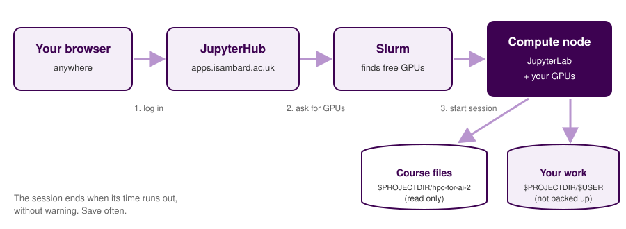
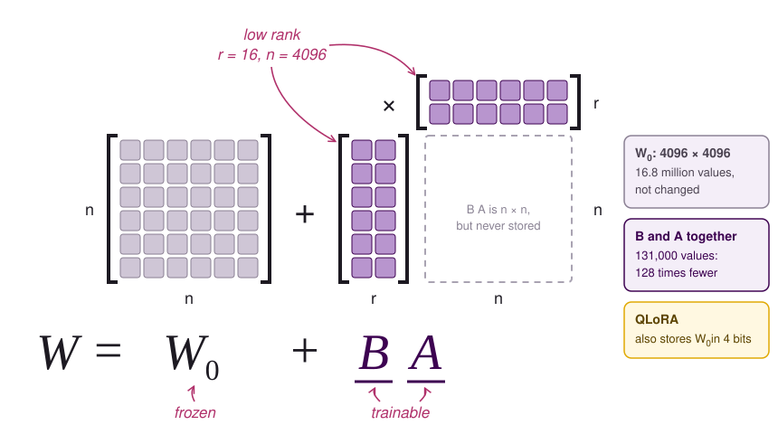
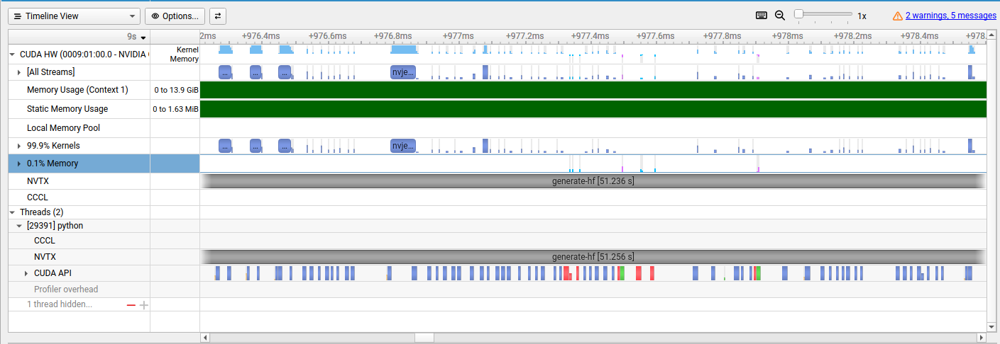
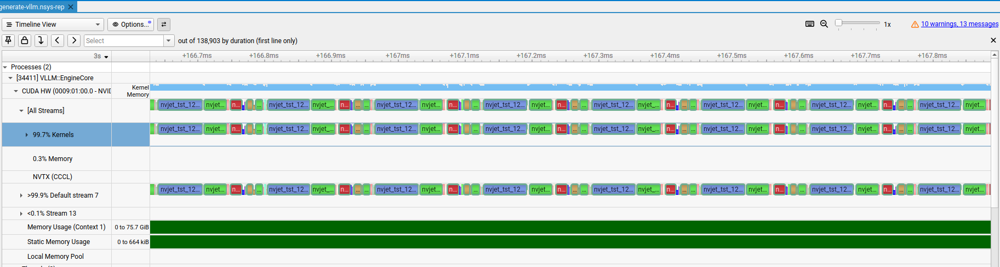

## The plan

::: {.flow}
[Set up]{.step} [→]{.arrow} [Fine-tuning?]{.step} [→]{.arrow} [Base model]{.step} [→]{.arrow} [LoRA and QLoRA]{.step}
:::

::: {.flow}
[Did it work?]{.step} [→]{.arrow} [vLLM]{.step} [→]{.arrow} [Prompting]{.step} [→]{.arrow} [Headlines]{.step} [→]{.arrow} [Wrap up]{.step}
:::

<br>

::: {.muted .center}
Optional at the end: profiling with Nsight Systems
:::

# [01]{.section-number} Setup {background-color="#3d0251"}

[How do I get a GPU with the model and data ready?]{.section-question}

## Asking for a GPU

{fig-alt="Your browser connects to JupyterHub, which asks the Slurm scheduler for GPUs. Slurm starts JupyterLab on a compute node with the GPUs you asked for, which reads the shared course files in $PROJECTDIR/hpc-for-ai-2 and saves your work to $PROJECTDIR/$USER." width="100%"}

## Start your session

:::: {.columns}
::: {.column width="50%"}
[apps.isambard.ac.uk/aip2-jupyter](https://apps.isambard.ac.uk/aip2-jupyter)

| Field | Choose |
|---|---|
| Project | *the course project* |
| Job duration | *until the end of the course* |
| Number of GH200s | 1 |
| Partition | *leave empty* |
| Reservation | `interactive` |
:::
::: {.column width="50%"}
::: {.bad}
When your time runs out, the session ends straight away, with no warning. Save regularly.
:::
:::
::::

::: notes
Share your screen and go slowly. This is where most problems happen: no UNIX username, not in the project, Partition filled in, or an old interactive job still running.
:::

## Set up the course kernel

In JupyterLab, go to **File → New → Terminal**

```{.bash filename="Terminal"}
bash $PROJECTDIR/hpc-for-ai-2/data/kernels/install-kernels.sh

cp $PROJECTDIR/hpc-for-ai-2/notebooks/hpc-for-ai-2.ipynb ~/
```

<br>

Reload the page, open your copy of `hpc-for-ai-2.ipynb`, and check the kernel in the top right says **Fine-tuning + Nsight**

## Where things live

| | |
|---|---|
| Course files | `$PROJECTDIR/hpc-for-ai-2` |
| Model | `data/hf-cache` |
| Datasets | `data/alpaca`, `data/headlines` |
| If you fall behind | `data/fallback` |
| Your results | `$PROJECTDIR/$USER/llm-fine-tuning` |

<br>

::: {.muted}
The model and data were downloaded before the course: the compute nodes can't reach the internet
:::

::: {.bad}
None of these are backed up
:::

# [02]{.section-number} What is fine-tuning? {background-color="#3d0251"}

[What does a base model do, and what will fine-tuning change?]{.section-question}

## What fine-tuning is

Fine-tuning starts from a model that has already been trained, and trains it a little further on a smaller, specific dataset

::: {.cards}
::: {.card}
**Starts from**
Mistral 7B, trained only to predict the next word
:::
::: {.card}
**Trains on**
3,200 Alpaca examples: an instruction, then its answer
:::
::: {.card}
**Learns**
To answer an instruction and stop, training under 1% of the parameters
:::
:::

<br>

::: {.muted .center}
It needs far less data and compute than training from scratch, because the model keeps most of what it already knows
:::

## A language model predicts the next token

:::: {.columns}
::: {.column width="55%"}
Text goes in as **tokens**: words or pieces of words

The model outputs a probability for every possible next token

To generate text, pick a token, add it to the input, and run again
:::
::: {.column width="45%"}
::: {.big .center}
7.3 billion
:::
::: {.center}
parameters in Mistral 7B
:::
:::
::::

<br>

::: {.center}
A base model only **continues** text. It hasn't been trained to answer questions.
:::

## Training, fine-tuning or RAG?

| | Training from scratch | Fine-tuning | RAG |
|---|---|---|---|
| What changes | All the weights | Some weights of a trained model | No weights: text added to the prompt |
| Data | Vast | Hundreds to thousands of labelled examples | Your documents |
| Compute | A very large cluster | One GPU, minutes to hours | Mostly at question time |
| Good for | New foundation models | A format, style or narrow skill | Facts the model doesn't have |

::: {.good}
Try prompting first. Use RAG for missing facts. Fine-tune for a format, style or skill.
:::

# [03]{.section-number} What can the base model do? {background-color="#3d0251"}

[What does the model do before any fine-tuning?]{.section-question}

## What can the base model do?

```{.python filename="hpc-for-ai-2.ipynb"}
streamer = TextStreamer(tokenizer, skip_prompt=True, skip_special_tokens=True)

inputs = tokenizer("What is the capital of France?", return_tensors="pt").to(base_model.device)
base_model.generate(**inputs, max_new_tokens=80, streamer=streamer)
```

<br>

::: {.center}
Look at how each answer **ends**. Does it stop, or carry on and write a new `### Instruction:` of its own?
:::

::: notes
Ask the room what the base model did with the direct question.
:::

# [04]{.section-number} Training with LoRA and QLoRA {background-color="#3d0251"}

[How do you fine-tune a 7-billion-parameter model on one GPU?]{.section-question}

## Full fine-tuning doesn't fit

::: {.cards}
::: {.card}
**16 bytes per parameter**
Weights, gradients, a 32-bit master copy and two optimiser values
:::
::: {.card}
**× 7.3 billion**
About 117 GB
:::
::: {.card}
**One GH200**
96 GB
:::
:::

## LoRA: learn a small update

{fig-alt="The equation W = W0 + B A, drawn as matrices. W0 is the pretrained n by n weight matrix, 4096 by 4096, about 16.8 million values, and is frozen. Added to it is the product of two thin matrices: B, n rows by r columns, and A, r rows by n columns, with r = 16. Their product has the same n by n shape as W0, but only B and A are stored and trained: about 131,000 values, around 128 times fewer. In QLoRA, W0 is also stored in 4 bits." width="100%"}

::: {.muted .center}
Only about 42 million of 7.3 billion parameters train: 0.58%
:::

## Train

```{.python filename="hpc-for-ai-2.ipynb"}
trainer = SFTTrainer(model=MODEL_ID, args=training_args, train_dataset=dataset,
                     processing_class=tokenizer, peft_config=lora_config)

with torch.cuda.nvtx.range("train"):
    result = trainer.train()
```

<br>

::: {.center}
About 8 minutes. The loss is printed every 10 steps and should fall.
:::

::: notes
While it trains, talk through LoRA and QLoRA, and what the room's results table will show. Anyone behind or whose training fails sets USE_FALLBACK = True.
:::

## LoRA vs QLoRA

| | LoRA | QLoRA |
|---|---|---|
| Training time | 8.0 min | 8.8 min |
| Peak GPU memory | 16.1 GiB | 5.8 GiB |
| Final loss | 0.903 | 0.908 |

<br>

::: {.good}
QLoRA is slower because it unpacks its 4-bit weights before every multiplication, which takes 18% of GPU time. It takes about 10% longer and uses about 64% less memory.
:::

::: {.center}
Use LoRA if the model fits in GPU memory, and QLoRA if it doesn't.
:::

::: notes
Re-run the whole room's results cell and compare it with this table.
:::

# [05]{.section-number} Did it work? {background-color="#3d0251"}

[Has the model learned to answer?]{.section-question}

## Base vs fine-tuned

```{.python filename="hpc-for-ai-2.ipynb"}
for question in QUESTIONS:
    print("Q:", question, "\nBASE MODEL:")
    with model.disable_adapter():
        ask(model, question)
    print("FINE-TUNED MODEL:")
    ask(model, question)
```

::: {.cards}
::: {.card}
**Seen in training**
The first question is Alpaca's first example
:::
::: {.card}
**Unseen**
The others show whether it learned to answer in general
:::
:::

::: {.muted .center}
Falling loss alone doesn't prove a model is better
:::

## Your turn ✍️ {background-color="#f4eef8"}

::: {.your-turn}
Add a question of your own to `QUESTIONS` and ask both models.

Can you find a question where the fine-tuned model is clearly **worse**?

It trained on 3,200 examples for 8 minutes, so it learned the question-and-answer format but no new facts.
:::

# [06]{.section-number} Faster inference with vLLM {background-color="#3d0251"}

[How do we get answers fast enough to use in a program?]{.section-question}

## How vLLM answers faster

::: {.cards}
::: {.card}
**Batching**
Work on all the questions at once: 32 questions become one matrix with 32 rows
:::
::: {.card}
**CUDA graphs**
Record the GPU work for one step once, then replay it, instead of Python launching every kernel
:::
:::

```{.python filename="hpc-for-ai-2.ipynb"}
llm = LLM(model=MODEL_ID, enable_lora=True, max_lora_rank=16,
          max_model_len=1024, gpu_memory_utilization=0.8)
```

::: notes
Run the vLLM start-up cell just before the break: it takes a minute or two.
:::

## Break {.center}

::: {.big .center}
15 minutes
:::

::: {.center}
Start the vLLM cell before you go
:::

## Same questions, much faster

```{.python filename="hpc-for-ai-2.ipynb"}
base_answers = llm.generate(prompts, settings)
tuned_answers = llm.generate(prompts, settings, lora_request=adapter)
```

<br>

::: {.good}
With Transformers, Python sends the GPU one small job at a time, for each question and each word, so the GPU spends most of its time waiting. vLLM sends the work in batches.
:::

## What the GPU is doing

{fig-alt="Nsight Systems timeline of about 2 milliseconds of the Transformers generate-hf run. The GPU kernel row shows short, sparse bars with gaps between them, while the CUDA API row underneath, on the Python thread, is busy launching one kernel after another." height="200px"}

{fig-alt="Nsight Systems timeline of about 1 millisecond of the vLLM generate-vllm run, in the vLLM engine process. The kernel row is a solid line of matrix multiplication kernels running back to back, with almost no gaps." height="170px"}

::: notes
Screenshots of the generate-hf and generate-vllm Nsight reports (the cell they just ran), zoomed in to a couple of milliseconds. GPU busy = total kernel time ÷ elapsed time, over the whole cell. Point at the gaps in the top kernel row and the busy CUDA API row under it: Python launching kernels one at a time. With vLLM the kernels run back to back. How to record and read these is in the optional profiling section at the end.
:::

# [07]{.section-number} Prompting from a program {background-color="#3d0251"}

[How do you use a model on a list of inputs, and trust what comes back?]{.section-question}

## One instruction, many inputs

```{.python filename="hpc-for-ai-2.ipynb"}
def run(instruction, inputs, settings=loop_settings, lora_request=adapter):
    """Ask one instruction for each input, all in one batch."""
    prompts = [TEMPLATE_WITH_INPUT.format(instruction=instruction, input=text) for text in inputs]
    outputs = llm.generate(prompts, settings, lora_request=lora_request)
    return [out.outputs[0].text.strip() for out in outputs]
```

::: {.center}
Give it the **whole list** at once, so vLLM can batch it
:::

## Check every answer

::: {.flow}
[Clean]{.step} [→]{.arrow} [Check]{.step} [→]{.arrow} [Retry failures]{.step} [→]{.arrow} [Mark as `None`]{.step .light}
:::

<br>

::: {.cards}
::: {.card}
**Clean**
Lower case, first word, no punctuation
:::
::: {.card}
**Retry**
Only the failures, with `temperature=0.7`
:::
::: {.card}
**Mark as `None`**
Rather than guess, so you can count failures
:::
:::

# [08]{.section-number} A research question {background-color="#3d0251"}

[Has each UK news outlet given more or less of its front page to the environment?]{.section-question}

## UK front pages

:::: {.columns}
::: {.column width="55%"}
- The lead headline of each UK outlet, from [The Hear](https://www.thehear.org)
- Sampled every 6 hours, September 2024 to October 2026
- Our fine-tuned model is the classifier: "about the environment? yes or no"
:::
::: {.column width="45%"}
::: {.big .center}
29,823
:::
::: {.center}
headlines
:::
:::
::::

## One at a time, or all at once?

| | One at a time | All at once |
|---|---|---|
| Headlines | 50 | 29,823 |
| Time per headline | 28 ms | 1.7 ms |
| GPU busy | 66% | 98% |

<br>

::: {.good}
Gather the inputs into a list and classify them in one call
:::

## Your turn ✍️ {background-color="#f4eef8"}

::: {.your-turn}
1. Look at the plot. Which outlets lead most often with the environment?
2. Check the random sample by eye: are they really about the environment?
3. Change the definition in `CLASSIFY`, or use the base model (`lora_request=None`). How many labels change, and which do you trust more?
:::

# [09]{.section-number} Wrapping up {background-color="#3d0251"}

[How far can we trust this?]{.section-question}

## How far can we trust this?

::: {.cards}
::: {.card}
**The classifier**
It was never taught what counts as "the environment"
:::
::: {.card}
**Lead stories only**
Not everything each outlet published
:::
::: {.card}
**Partial years**
2024 starts in September, 2026 ends in October
:::
::: {.card}
**Sampling**
Every 6 hours misses short-lived leads
:::
:::

## Using a shared supercomputer well

::: {.good}
Save regularly, and check your time left with `squeue` (the command is in the notes)
:::

::: {.good}
Share one copy of large model files in the project folder
:::

::: {.good}
Nothing on Isambard-AI is backed up: copy anything important somewhere safe
:::

## Where to go next

- [Isambard-AI LLM tutorials](https://docs.isambard.ac.uk/user-documentation/tutorials/llms/fine-tuning/)
- [Introduction to HPC](https://bristol-training.github.io/intro-hpc/): scripts, batch jobs and Slurm
- [Harnessing AI](https://bristol-training.github.io/harnessing-ai/): responsible use of language models
- The TRL, PEFT and vLLM documentation
- [Applying for Isambard-AI access](https://docs.isambard.ac.uk/access/)

## Before you go {.center}

::: {.big .center}
Please stop your server
:::

::: {.center}
File → Hub Control Panel → **Stop My Server**
:::

::: notes
Check everyone has stopped their server, and share the feedback form link.
:::
